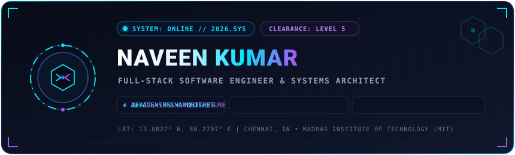

<div align="center">

<!-- HERO BANNER WITH GLASSOMORPHIC BLINKING NAME -->


<br/><br/>

<!-- ANIMATED TYPING BANNER -->
<a href="https://github.com/NaveenKumar3026">
  
</a>

<br/>

<!-- PROFILE TELEMETRY BADGES -->
<p align="center">
  <a href="https://github.com/NaveenKumar3026">
    
  </a>
  <a href="https://github.com/NaveenKumar3026">
    
  </a>
  <a href="mailto:naveen3026mit@gmail.com">
    
  </a>
  <a href="https://github.com/NaveenKumar3026">
    
  </a>
</p>

<!-- SOCIAL QUICK-LINKS -->
<p align="center">
  <a href="https://github.com/NaveenKumar3026" target="_blank">
    
  </a>
  &nbsp;
  <a href="https://www.linkedin.com/in/naveen-kumar191206/" target="_blank">
    
  </a>
  &nbsp;
  <a href="mailto:naveen3026mit@gmail.com">
    
  </a>
  &nbsp;
  <a href="https://github.com/NaveenKumar3026?tab=repositories">
    
  </a>
</p>


</div>

<br/>

<!-- ========================================== -->
<!-- 01. SYSTEM OVERVIEW // ABOUT ME            -->
<!-- ========================================== -->


<br/>

```yaml
identity: Naveen Kumar S
institution: Madras Institute of Technology (MIT), Anna University
degree: Bachelor of Engineering (B.E.) in Computer Science and Engineering
focus_domains: [Computer Vision, Full-Stack Development, Distributed Backends, Kernel Systems]
engineering_ethos: "Algorithmic precision, real-time edge intelligence, and resilient system design."
```

I am a Software Engineer and Computer Science Scholar at the **Madras Institute of Technology (MIT), Anna University**. I bridge algorithmic foundations with practical, high-impact software engineering spanning **computer vision**, **network security intelligence**, **kernel operating systems**, and **scalable full-stack platforms**.

Whether developing an **AI Smart Gym Mirror with real-time biomechanical pose estimation**, authoring **threat defense pipelines with SSRF hardening**, or optimizing **xv6 kernel CPU scheduling**, I build software focused on determinism, low-latency execution, and clean architectural design.

### Engineering Focus & Academic Foundation

- **Madras Institute of Technology (MIT):** Pursuing B.E. in Computer Science and Engineering with a deep foundation in systems programming, operating systems, networks, and algorithms.
- **Computer Vision & Edge AI:** Architecting real-time pose estimation, skeletal landmark tracking, and kinematic feedback engines for interactive edge hardware.
- **Full-Stack Systems:** Developing type-safe web architectures, API gateways, and responsive user interfaces.
- **Algorithmic Discipline:** Applying Data Structures, Graph Algorithms, and modular design patterns across production environments.

<br/>

<div align="center">
  
</div>

<br/>

<!-- ========================================== -->
<!-- 02. TECHNICAL ARSENAL                      -->
<!-- ========================================== -->


<br/>

<table>
  <tr>
    <td width="30%" valign="top">
      <b>PROGRAMMING LANGUAGES</b>
    </td>
    <td width="70%">
      
      
      
      
      
      
      
      
      
    </td>
  </tr>
  <tr>
    <td width="30%" valign="top">
      <b>AI &amp; COMPUTER VISION</b>
    </td>
    <td width="70%">
      
      
      
      
      
    </td>
  </tr>
  <tr>
    <td width="30%" valign="top">
      <b>BACKEND &amp; SYSTEMS</b>
    </td>
    <td width="70%">
      
      
      
      
      
      
    </td>
  </tr>
  <tr>
    <td width="30%" valign="top">
      <b>FRONTEND &amp; UI ENGINEERING</b>
    </td>
    <td width="70%">
      
      
      
      
      
    </td>
  </tr>
  <tr>
    <td width="30%" valign="top">
      <b>DATABASES &amp; STORAGE</b>
    </td>
    <td width="70%">
      
      
      
      
      
    </td>
  </tr>
  <tr>
    <td width="30%" valign="top">
      <b>TOOLS &amp; INFRASTRUCTURE</b>
    </td>
    <td width="70%">
      
      
      
      
      
      
    </td>
  </tr>
</table>

<br/>

<div align="center">
  
</div>

<br/>

<!-- ========================================== -->
<!-- 03. FLAGSHIP BUILDS                        -->
<!-- ========================================== -->


<br/>

<!-- PROJECT 1: AI SMART GYM MIRROR -->
### 01. [AI Smart Gym Mirror](https://github.com/NaveenKumar3026)
> **Architecture:** Python • OpenCV • MediaPipe Pose Estimation • React 18 • WebSocket • Node.js • Tailwind CSS • Glassmorphic HUD

```
[ Camera Stream ] ---> [ MediaPipe Pose Detection ] ---> [ Angle & Joint Vector Engine ]
                              (33 Keypoints)                         |
                                                                     v
[ Real-Time Display HUD ] <--- [ Form Feedback & Rep Counter ] <--- [ Biomechanical Heuristics ]
    (Glassmorphic UI)           (Concentric / Eccentric Curve)           (Injury Prevention)
```

- **Problem:** Improper biomechanics during strength training cause acute musculoskeletal strain, joint wear, and training fatigue without an expert trainer present.
- **Solution:** Built an interactive gym mirror combining computer vision, skeletal joint tracking, and edge AI to analyze exercises in real time.
- **Key Engineering Features:**
  - **3D Landmark Pose Estimation:** Evaluates 33 body landmarks via high-frequency camera streams to calculate real-time joint angles for squats, lunges, curls, and presses.
  - **Dynamic Biomechanical Correction:** Detects form deviations (knee collapse, spinal rounding, unequal extension) and generates instantaneous audio/visual corrections.
  - **Concentric & Eccentric Repetition Tracking:** State-machine algorithm measuring inflection thresholds to guarantee accurate rep counts with zero false positives.
  - **Glassmorphic Mirror HUD:** High-contrast, glare-optimized dark interface displaying velocity metrics, set timers, and joint angle telemetry over the mirror reflection.

<br/>

<!-- PROJECT 2: SHIELD AI -->
### 02. [Shield AI](https://github.com/NaveenKumar3026)
> **Architecture:** TypeScript Monorepo • Node.js • Express • Prisma ORM • React • Vite • Tailwind CSS • Zod • Docker

- **Domain:** Cyber Defense, Anti-Fraud & Scam Investigation.
- **Solution:** An investigative digital platform that inspects suspicious links, deceptive recruitment offers, predatory contracts, and fraudulent messages like a forensic case file.
- **Key Engineering Features:**
  - **TruthLens Risk Engine:** Pairs deterministic heuristic signal extraction with explainable AI reasoning for transparent fraud scoring.
  - **SSRF-Hardened Security:** Built-in network safeguards preventing Server-Side Request Forgery by isolating untrusted inputs and blocking internal subnets.
  - **Type-Safe Domain Monorepo:** Shared TypeScript types and Zod schemas across microservices ensuring absolute contract integrity.

<br/>

<!-- PROJECTS 3, 4, 5, 6 GRID -->
<table>
  <tr>
    <td width="50%" valign="top">
      <h3>03. <a href="https://github.com/NaveenKumar3026/MitiMUN">MitiMUN</a></h3>
      <p><b>Architecture:</b> React 18 • TypeScript • Vite • Tailwind CSS • Recharts</p>
      <p>A mission-critical event management and delegate conference platform engineered for Model United Nations conventions. Features dynamic delegate registries, committee allocation workflows, live agenda management, and real-time voting data visualization.</p>
    </td>
    <td width="50%" valign="top">
      <h3>04. <a href="https://github.com/NaveenKumar3026">Evoverse</a></h3>
      <p><b>Architecture:</b> Python • Simulation Engine • Multi-Agent Modeling • Genetic Algorithms • WebGL</p>
      <p>An evolutionary computing and artificial life simulator modeling entity survival, dynamic neural adaptation, genetic crossover, mutation rates, and ecological equilibrium across real-time multi-agent environments.</p>
    </td>
  </tr>
  <tr>
    <td width="50%" valign="top">
      <h3>05. <a href="https://github.com/NaveenKumar3026">NetShield AI</a></h3>
      <p><b>Architecture:</b> Python • C++ • Packet Inspection • Machine Learning • FastAPI • Linux Sockets</p>
      <p>An intelligent network intrusion detection and threat mitigation engine. Executes deep packet inspection, real-time signature matching, and machine learning anomaly classification to intercept malicious protocol anomalies and DDoS vectors.</p>
    </td>
    <td width="50%" valign="top">
      <h3>06. <a href="https://github.com/NaveenKumar3026">Adaptive Intelligence xv6</a></h3>
      <p><b>Architecture:</b> C • xv6 Unix Kernel • x86 Assembly • QEMU Emulation</p>
      <p>An operating systems kernel engineering project enhancing MIT xv6 with an intelligent multi-level feedback queue (MLFQ) scheduler that adaptively reprioritizes CPU cycles based on process I/O and compute workloads.</p>
    </td>
  </tr>
</table>

<br/>

<div align="center">
  
</div>

<br/>

<!-- ========================================== -->
<!-- 04. GITHUB TELEMETRY, PRS & ACTIVE DAYS    -->
<!-- ========================================== -->


<br/>

<div align="center">

<!-- GITHUB PROFILE SUMMARY CARDS (2x2 GRID) -->
<p align="center">
  
  
</p>

<p align="center">
  
  
</p>

<br/>

<!-- CONTRIBUTION STREAK: ACTIVE DAYS & LONGEST STREAK -->
<p align="center">
  <a href="https://github.com/NaveenKumar3026">
    
  </a>
</p>

</div>

<br/>

<div align="center">
  
</div>

<br/>

<!-- ========================================== -->
<!-- 05. ACTIVE RESEARCH & DEEP EXPLORATIONS    -->
<!-- ========================================== -->


<br/>

<table width="100%">
  <tr>
    <td width="50%" valign="top">
      <h4>Real-Time Computer Vision &amp; Kinematics</h4>
      <p>Researching sub-millisecond edge pose tracking, multi-camera angle fusion, and biomechanical velocity analytics using <b>Python, OpenCV, and MediaPipe</b>.</p>
    </td>
    <td width="50%" valign="top">
      <h4>Kernel Engineering &amp; Operating Systems</h4>
      <p>Deep-diving into low-level CPU scheduler algorithms, virtual memory paging, system-call instrumentation, and kernel concurrency patterns in <b>C and xv6</b>.</p>
    </td>
  </tr>
  <tr>
    <td width="50%" valign="top">
      <h4>Advanced Data Structures &amp; Algorithms</h4>
      <p>Mastering dynamic programming, graph theory, segment trees, and competitive algorithmic problem solving in <b>C++ and Java</b>.</p>
    </td>
    <td width="50%" valign="top">
      <h4>Secure Full-Stack Application Design</h4>
      <p>Hardening web APIs against OWASP vulnerabilities, SSRF mitigation, strict type validation (Zod), and token-based authentication.</p>
    </td>
  </tr>
</table>

<br/>

<div align="center">
  
</div>

<br/>

<!-- ========================================== -->
<!-- 06. CONNECT & ESTABLISH UPLINK             -->
<!-- ========================================== -->


<br/>

<div align="center">

<p align="center">
  <b>Always interested in full-stack engineering roles, computer vision challenges, and open-source collaborations:</b>
</p>

<p align="center">
  <a href="mailto:naveen3026mit@gmail.com">
    
  </a>
  &nbsp;
  <a href="https://www.linkedin.com/in/naveen-kumar191206/" target="_blank">
    
  </a>
  &nbsp;
  <a href="https://github.com/NaveenKumar3026" target="_blank">
    
  </a>
</p>

<br/>

<!-- FOOTER ANIMATED BANNER -->


<br/>

<p align="center">
  <sub>Designed with glassomorphic cyberpunk precision &bull; Engineered by <b>Naveen Kumar S</b> &bull; Madras Institute of Technology (MIT) &copy; 2026</sub>
</p>

</div>
